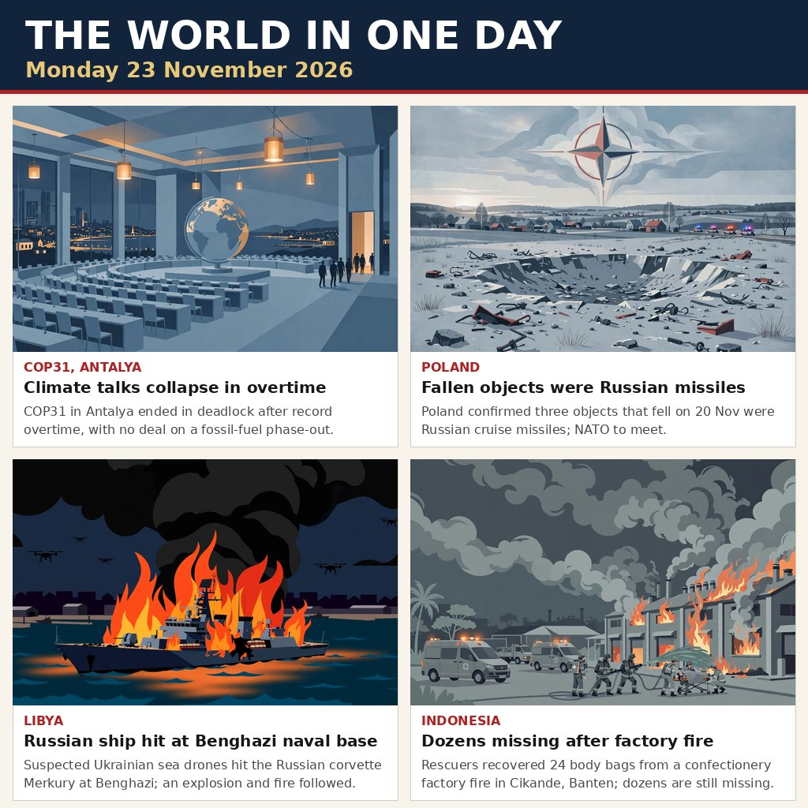

# The World in One Day — Monday 23 November 2026


A one-image front page summing up the world news of Monday 23 November 2026,
built for the [make.fun](https://make.fun/c/news-image-20261123) bounty
`news-image-20261123` ($100, 50 paid places).



## The four stories

1. **COP31, Antalya — Climate talks collapse in overtime.** COP31 ended in
   deadlock after record overtime, with no deal on a fossil-fuel phase-out.
   (BBC, "COP31 fails to reach major climate deal"; The Hindu and others.)
2. **Poland — Fallen objects were Russian missiles.** Poland confirmed the
   three objects that fell on 20 November were Russian cruise missiles;
   NATO was to meet. (Reported 23 November 2026.)
3. **Libya — Russian ship hit at Benghazi naval base.** Suspected Ukrainian
   sea drones hit the Russian corvette Merkury at Benghazi; an explosion and
   fire followed. (Reuters, BBC, The Hindu and others.)
4. **Indonesia — Dozens missing after factory fire.** Rescuers recovered 24
   body bags from a confectionery factory fire in Cikande, Banten; dozens
   are still missing. (Reported 23 November 2026.)

## How the image was made

Four scene illustrations were generated fresh for this entry in a flat
editorial style, with no text inside them. They were then composed into a
1024×1024 front page with a navy masthead (title + gold date line) and a
2×2 grid of white cards using `compose.py` (Python + Pillow, DejaVu fonts);
every kicker, headline and body line is typeset by the script, so nothing
in the image is garbled. The entry image is `entry.png` (JPEG, 1024×1024,
under 1 MiB).

## Running it

`main.ts` (Node 22, standard library only) copies `./entry.png` to
`$MAKEFUN_OUTPUT_DIR/entry.png`:

```sh
mkdir -p out && MAKEFUN_OUTPUT_DIR=out node main.ts
```

That writes `out/entry.png`, byte-identical to the `entry.png` in this repo.
